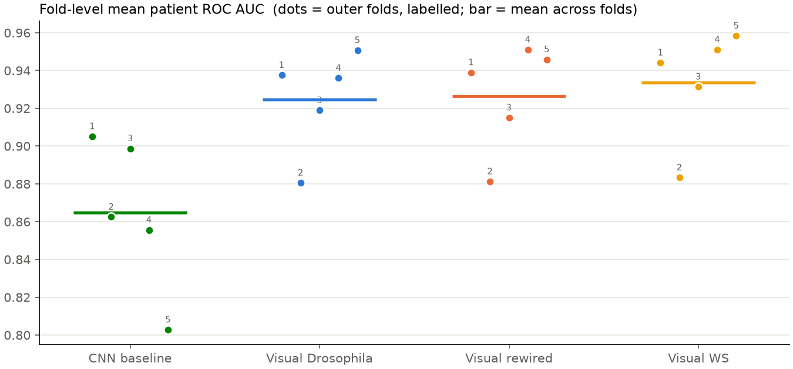
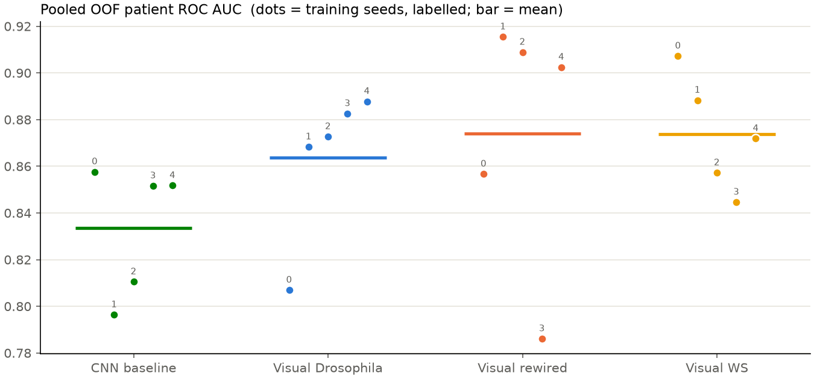
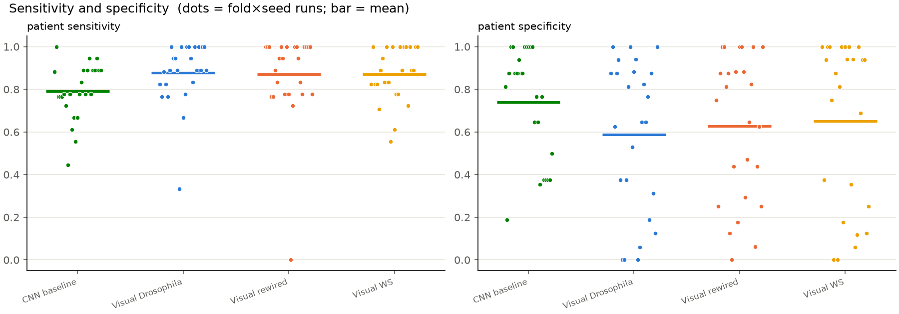

# Connectome-Constrained Neural Networks for Brain MRI Classification: A Controlled Comparison of Drosophila Visual Wiring and Matched Graph Topologies

*First draft, generated from the frozen FlyConnectomeMRI repository (Phases 8–10; `docs/results/`). Every number is taken from frozen result files. Items marked [CITATION NEEDED] or [VERIFY] must be resolved before submission.*

---

## Abstract

Biological connectomes are increasingly used as structural priors for artificial neural networks, but it is rarely tested whether the *specific* biological wiring matters more than its coarse graph statistics. We asked whether a network constrained by real *Drosophila* visual-system connectivity behaves differently from matched non-biological topologies on a human brain MRI task.

From the MaleCNS v1.0 connectome we extracted a 128-neuron, 989-edge local retinotopic patch of annotated columnar visual neurons. We used it as a fixed, sparse propagation mask between a small CNN encoder and a linear classifier. The same architecture was trained with a degree-preserving rewired version of the graph (the primary null model) and with Watts–Strogatz-type, Erdős–Rényi and Barabási–Albert controls. The task was glioma-versus-meningioma classification on the Cheng et al. Figshare dataset (171 patients, 2,134 T1-weighted contrast-enhanced slices).

The main evaluation was leakage-safe cross-validation using the official Figshare outer test folds, with 5 folds × 5 seeds per model and every patient tested exactly once. Across 25 paired fold×seed runs, the patient-level ROC AUC difference between the Drosophila graph and its rewired control was −0.002 ± 0.030 (Drosophila higher in 12 of 25 runs). At fold level it was −0.002 ± 0.008. Graph-constrained models, whether biological or not, reached higher ROC AUC than a simple CNN baseline; the biological wiring did not.

Under the evaluated setting, the Drosophila visual connectome did not provide a measurable topology-specific advantage. No statistical significance or clinical validity is claimed.

---

## 1. Introduction

Connectomes, the complete synaptic wiring diagrams of nervous systems, have become available at cellular resolution for several model organisms. This has motivated artificial neural networks whose connectivity is constrained by biological graphs: for example, networks wired after the *C. elegans* nervous system [6] [CITATION NEEDED: published NCNN paper], and connectome-constrained models of the *Drosophila* visual system [5] [CITATION NEEDED: FlyVis publication]. The underlying hypothesis is that wiring shaped by evolution may be a useful inductive bias for artificial learning systems.

Testing this hypothesis requires more than showing that a connectome-wired network learns a task. A biologically wired network differs from a conventional one in many ways at once: it is sparse, it has a particular degree distribution, reciprocity and clustering, and it adds extra layers and parameters. Any performance difference can come from any of these properties rather than from the biological identity of the connections. The appropriate control is therefore a *matched* graph that keeps generic properties such as node count, edge count and each node's in- and out-degree, but destroys the specific partner identities. Degree-preserving rewiring provides exactly such a null model [CITATION NEEDED: Maslov & Sneppen, degree-preserving rewiring].

We study this question on a human medical imaging task that is deliberately unrelated to the biological function of the circuit: binary classification of brain tumour type (glioma vs meningioma) from T1-weighted contrast-enhanced MRI. We do not expect insect visual circuitry to encode knowledge about human brain tumours. The question is only whether its *topology*, used as a structural prior, changes what a small network learns compared with matched topologies. To our knowledge, few studies have evaluated real insect connectome topology as a structural prior for human medical image classification [VERIFY: literature search required before any novelty claim].

Our contributions are:
1. **Real connectome as a structural constraint.** We used a real *Drosophila* visual-system subgraph (MaleCNS v1.0, selected only by cell-type and retinotopic column annotations) as a sparse constraint in an MRI classifier. Only the strengths of existing edges are trainable.
2. **Matched null models.** Each biological graph was compared with matched controls: degree-preserving rewired (primary), ER, WS-type and BA-type. The architecture, parameter count and training protocol are identical across the graph models.
3. **Leakage-aware evaluation.** Evaluation was at patient level, with a conservative grouping of possibly related examinations and leakage-safe cross-validation that keeps the official outer test folds.
4. **A pre-registered, controlled negative result.** The specific biological wiring gave no measurable advantage over its rewired control, while graph-constrained architectures in general outperformed a simple CNN baseline.

---

## 2. Related Work

**Connectome-constrained and bio-inspired network topologies.** Networks whose layer connectivity is defined by biological wiring diagrams have been proposed for the *C. elegans* connectome and compared against classical random graph families (Erdős–Rényi, Watts–Strogatz, Barabási–Albert) [6] [CITATION NEEDED: NCNN publication; ER, WS and BA original papers]. Related work on randomly wired architectures suggests that the generator of the wiring pattern, rather than hand design, can drive performance [CITATION NEEDED: randomly wired neural networks for image recognition]. That line of work also implies that biological topologies need strong random-graph controls.

**Drosophila visual connectome models.** The *Drosophila* optic lobe is organised into repeating retinotopic columns containing stereotyped cell types. Its motion-detection pathways (lamina L1–L3; medulla Mi1, Mi4, Mi9, C3; transmedullary Tm1, Tm2, Tm4, Tm9; and the T4/T5 direction-selective neurons) have been characterised from electron microscopy [CITATION NEEDED: Takemura et al.; Shinomiya et al.; review of fly motion vision]. Connectome-constrained models of this system have been trained to predict neural activity [5] [CITATION NEEDED: FlyVis publication]. Whole-CNS connectomes such as MaleCNS [3] and the neuPrint platform [4] now make it possible to extract such circuits programmatically.

**Graph-structured inductive biases.** Graph neural networks and sparse, graph-masked layers impose relational structure on learned representations [CITATION NEEDED: GNN survey or reference]. Whether a *specific* graph helps, beyond its sparsity and degree statistics, is an empirical question that requires matched null graphs.

**Brain tumour MRI classification.** The Figshare dataset of Cheng et al. [1], [2] has been widely used for three-class tumour classification (meningioma, glioma, pituitary) [7] [CITATION NEEDED: representative CNN studies on this dataset]. Many public MRI tumour collections lack patient identifiers, which risks slice-level leakage [CITATION NEEDED: data leakage in medical imaging]. The Cheng dataset provides patient IDs and official cross-validation indices [2], which makes patient-level evaluation possible.

---

## 3. Materials and Methods

### 3.1 MRI Dataset

We used the original `.mat` release of the Cheng et al. brain tumour dataset (Figshare article 1512427, version 8, CC BY 4.0) [2].
- **Contents:** 3,064 T1-weighted contrast-enhanced slices from 233 patients: 708 meningioma slices (82 patients), 1,426 glioma (89) and 930 pituitary (62).
- **Integrity:** all files were verified against Figshare's published MD5 checksums and kept unmodified and read-only.
- **Labels and patient IDs:** these were read from the original `cjdata.label` and `cjdata.PID` fields.
- **Task:** glioma (positive) vs meningioma. Pituitary tumours were excluded from this binary task. This leaves **171 patients and 2,134 slices** (1,426 glioma, 708 meningioma), with no exact duplicate images.
- **Preprocessing:** each slice was min–max scaled by its own intensity range (following the dataset authors' conversion script), bilinearly resized to 128×128 (15 slices are natively 256×256), and normalised with mean and standard deviation computed on the training split only. No data augmentation was used.

With slice intensities $x$, the per-slice scaling and the train-only normalisation are:

$$\tilde{x} = \frac{x - \min(x)}{\max(x) - \min(x)}, \qquad \hat{x} = \frac{\mathrm{resize}_{128\times128}(\tilde{x}) - \mu_{\mathrm{train}}}{\sigma_{\mathrm{train}}}$$

**Possible site-related confounding.** Patient IDs occur in two formats: `MR`-prefixed IDs and purely numeric IDs. All 67 `MR`-prefixed patients are gliomas; the 104 numeric-ID patients comprise 22 gliomas and 82 meningiomas. The dataset documentation reports acquisition at two hospitals but does not say what the ID formats mean. The association may therefore reflect site or scanner differences, but this is not established. Absolute classification performance must be interpreted cautiously. The confound affects all compared models identically.

### 3.2 Leakage-Safe Patient-Level Evaluation

**Conservative grouping of possibly related examinations.** Some `MR`-prefixed IDs share a base number and differ only by a letter suffix (for example `MR040240`, `MR040240B`, `MR040240C`, `MR040240D`). Whether these are the same person is unknown. As a conservative leakage-prevention assumption, we assigned a `patient_link_key` (regular expression `^(?P<base>MR\d{6})[A-Z]?$`) that groups 42 IDs into 18 families. The published `patient_id` values were not changed.

**Fixed split (initial experiments).** A deterministic, class-stratified group split (seed 0) assigned entire linked groups to one partition:
- train: 124 patients, 1,506 slices;
- validation: 26 patients, 326 slices;
- test: 21 patients, 302 slices.

There was no patient or link-key overlap between partitions.

**Leakage-safe cross-validation using the official Figshare outer test folds (main experiment).** The dataset provides official five-fold indices (`cvind.mat`), which map cleanly to the published patient IDs. However, 16 of the 18 link families span different official folds. For outer fold *k*:
- **Test:** the official fold *k*, **unchanged**.
- **Validation:** the next official fold, cyclically (1→2, 2→3, 3→4, 4→5, 5→1), minus any patient whose link key occurs in the test set.
- **Training:** the remaining three folds, minus any patient whose link key occurs in the test set or in the cleaned validation set.

No patient was moved between folds or replaced. Official fold values were not altered. Between 11 and 19 linked patients were excluded from training and validation per outer fold; all of them were `MR`-prefixed gliomas. The resulting partitions have zero `patient_id` and zero `patient_link_key` overlap in every fold, and **every one of the 171 patients is in exactly one outer test fold**.

This is therefore *not* an exact reproduction of the dataset authors' five-fold protocol. It preserves their test folds but applies an additional exclusion rule to training and validation. The training `pos_weight` (negatives/positives) and the normalisation statistics were recomputed per fold from the cleaned training set only, giving `pos_weight` values of 0.679, 0.663, 0.779, 0.798 and 0.597 for folds 1–5.

### 3.3 Drosophila Connectome Construction

**Source and extraction.** Connectivity was obtained from MaleCNS v1.0 [3] through neuPrint [4] (`male-cns:v1.0`, neuprint-python 0.6.3, database uuid `4b2087c0…`). For a selected set of neurons we retrieved all directed connections among them.
- **Edges and weights:** an edge *i→j* carries the total synapse count from presynaptic neuron *i* to postsynaptic neuron *j*.
- **Validation:** edge lists were checked for missing values, non-positive weights and duplicates.
- **Isolated neurons:** kept as nodes.
- **Self-loops:** removed before use.
- **Provenance:** all downloads are recorded with checksums.

**Engineering graph (EB).** Before selecting a visual graph, we validated the pipeline on a *generic* graph: the 128 neurons with the most synapses in the ellipsoid body (EB), a navigation-related central-complex region that is not part of the visual system. With all connections kept, this graph had a density of 0.79. Before any MRI training we pre-declared a sparser variant keeping only edges with at least 20 synapses (w20). It has 3,047 edges, density 0.187, reciprocity 0.52, clustering 0.50 and one strongly connected component. The EB graph is reported only as an initial topology experiment and is never labelled as visual.

### 3.4 Visual-System Graph Selection

**Choice of strategy.** We compared three candidate strategies on biological and graph criteria only, without using MRI data:
- (A) the top-128 neurons by synapse count in the medulla ME(R);
- (B) an annotation-defined local retinotopic patch;
- (C) the top-128 right-side visual projection neurons.

Strategy B was chosen. It represents a canonical, repeated circuit, is defined only by verified annotations, and is naturally sparse.

**Selection rule for strategy B.**
- **Candidates:** neurons of 11 columnar cell types of the ON/OFF motion-pathway input stage (L1, L2, L3, Mi1, Mi4, Mi9, C3, Tm1, Tm2, Tm4, Tm9) that have synapses in ME(R) and an assigned retinotopic column (`assignedOlHex1/2`).
- **Central column:** the median (hex1, hex2) over the 817 columns containing all 11 types, which is (18, 20).
- **Ordering:** neurons were ordered by hexagonal distance from the central column, with neighbour offsets verified on L1 soma positions, then by column coordinates, fixed type order and bodyId. The first 128 were kept.

The resulting patch spans 12 columns: the central column and its first ring are complete, and the second ring is partially filled. It contains 12 neurons of each of L1, L2, L3, Mi1, Mi4, Mi9 and C3, and 11 of each of Tm1, Tm2, Tm4 and Tm9.

**Properties of the primary graph** (all edges retained, weight ≥ 1):
- 989 directed edges, density 0.061;
- mean in/out-degree 7.7, maximum in-degree 38 and out-degree 20;
- reciprocity 0.51, clustering 0.38;
- 12 strongly connected components, the largest with 117 nodes.

**Biological plausibility.** The strongest type-to-type connections reproduce known pathways: L2→Tm2/Tm1/Tm4, L1→Mi1, L3→Mi9, Mi4→Mi9 and C3→L2. The small strongly connected components have a biological explanation: seven L3 cells receive their input from photoreceptors, and three Tm9 cells project to T5, neither of which is included.

**What is not included.** T4/T5 and Tm3 have no column assignment in MaleCNS. They were not included, and no column was inferred for them. The graph is therefore a local input-stage circuit, not a complete motion detector. A variant keeping only edges of at least 5 synapses (w≥5, 411 edges) was defined as a sensitivity analysis only and is not part of the results reported here.

### 3.5 Control Graphs

For each biological graph, control graphs were generated from five seeds (0–4). Each has the same 128 nodes and **exactly the same number of directed edges**, with no self-loops. Training seed *s* is paired with control-graph seed *s*.
- **Degree-preserving rewired (primary null model):**
  - **Construction:** directed double-edge swaps, 10 attempted swaps per edge (Eq. 2). A swap is rejected if it would create a self-loop or a duplicate edge.

$$(a \rightarrow b,\; c \rightarrow d) \;\longmapsto\; (a \rightarrow d,\; c \rightarrow b), \qquad a \neq d,\; c \neq b,\; (a \rightarrow d),(c \rightarrow b) \notin \mathcal{E}$$

  - **What it preserves:** every node's exact in- and out-degree.
  - **What it destroys:** the biological partner identities. On the visual graph, reciprocity drops from 0.51 to 0.08 and clustering from 0.38 to 0.10 (means over seeds), and 13% of edges coincide with biological edges, near the chance level for the given degree sequence.
- **Erdős–Rényi (ER):** directed G(n, m); edges uniformly at random among all ordered pairs.
- **Watts–Strogatz-type (WS):** a directed variant defined in the project. It starts from a ring lattice with the exact edge count and rewires each edge's target with probability 0.1. It has high reciprocity (0.80) and clustering (0.48) but nearly uniform degrees.
- **Barabási–Albert-type (BA):** a directed variant defined in the project, built from undirected preferential attachment with random edge directions and trimmed to the exact edge count. It produces hubs and has zero reciprocity.

The directed WS and BA constructions are project-specific documented definitions, not universal standards. Their construction rules are frozen and guarded by golden-hash regression tests.

**TABLE II.** Visual graph and control graph properties (128 nodes and 989 edges each; controls: mean over seeds 0–4).

| Graph | Density | Max in / out degree | Reciprocity | Clustering | SCCs | Overlap with biological edges |
|---|---|---|---|---|---|---|
| Visual Drosophila (w≥1) | 0.061 | 38 / 20 | 0.510 | 0.381 | 12 (largest 117) | 1.000 |
| Degree-preserving rewired | 0.061 | 38 / 20 | 0.084 | 0.097 | 11.2 | 0.130 |
| ER | 0.061 | 14.4 / 15.6 | 0.057 | 0.062 | 1.2 | 0.057 |
| WS (directed variant) | 0.061 | 11.2 / 8.0 | 0.795 | 0.479 | 1.0 | 0.065 |
| BA (directed variant) | 0.061 | 29.2 / 28.6 | 0.000 | 0.102 | 1.0 | 0.056 |
| *Reference:* EB w20 (Phase 8) | 0.187 | 53 / 71 | 0.519 | 0.496 | 1 | n/a (3,047 edges) |

### 3.6 Neural Network Architectures

All models share one small CNN encoder (Fig. 3):
- 1×128×128 input;
- Conv3×3(1→16)–ReLU–MaxPool;
- Conv3×3(16→32)–ReLU–MaxPool;
- Conv3×3(32→128)–ReLU;
- global average pooling, giving a 128-dimensional feature vector.

It has no batch normalisation, dropout, pretraining or augmentation.

**CNN baseline.** The 128 features feed a Linear(128→1) layer. It has 41,921 parameters.

**Graph-constrained model.** The 128 features are batch-normalised (BatchNorm1d), and feature *i* initialises the scalar state of graph node *i*. Two propagation layers then update the node states (Eqs. 3–6 below):
- **Signal direction:** signals flow only from presynaptic to postsynaptic nodes.
- **Edge weights:** there is exactly one trainable weight per existing edge, with fan-in initialisation. Non-existent edges have no parameter, which is equivalent to $W \odot A$ for a binary adjacency mask $A$. Synapse counts define which edges exist, not their initial strength.
- **Output:** all 128 final node states feed a Linear(128→1) classifier.
- **No bypass:** there is no skip connection from encoder to classifier, so all information reaching the prediction passes through the graph.

Formally, let $\phi$ denote the convolutional encoder with global average pooling, $\mathcal{E}$ the directed edge set and $A$ its binary adjacency matrix ($A_{ij}=1$ if $(i\rightarrow j)\in\mathcal{E}$). The graph model computes

$$\mathbf{f} = \phi(\hat{x}) \in \mathbb{R}^{128}, \qquad \mathbf{h}^{(0)} = \mathrm{BN}(\mathbf{f})$$

$$h^{(\ell)}_j = \mathrm{ReLU}\left( \sum_{i:\,(i\rightarrow j)\in\mathcal{E}} w^{(\ell)}_{ij}\, h^{(\ell-1)}_i + b^{(\ell)}_j \right), \qquad \ell = 1, 2$$

which is equivalent to the masked dense form

$$\mathbf{h}^{(\ell)} = \mathrm{ReLU}\left( \left(W^{(\ell)} \odot A\right)^{\top} \mathbf{h}^{(\ell-1)} + \mathbf{b}^{(\ell)} \right)$$

in which only the $|\mathcal{E}|$ entries of $W^{(\ell)}$ with $A_{ij}=1$ exist as parameters. The weights and output are

$$w^{(\ell)}_{ij} \sim \mathcal{U}\left(-\frac{1}{\sqrt{k^{\mathrm{in}}_j}},\, \frac{1}{\sqrt{k^{\mathrm{in}}_j}}\right), \quad b^{(\ell)}_j = 0, \qquad z = \mathbf{v}^{\top}\mathbf{h}^{(2)} + c, \quad p = \sigma(z)$$

where $k^{\mathrm{in}}_j$ is the in-degree of node $j$ (at least 1). The CNN baseline uses $z = \mathbf{v}^{\top}\mathbf{f} + c$.

The visual-graph models have 44,411 parameters: encoder 41,792, BatchNorm 256, graph block 2×(989+128), classifier 129. The EB-graph models have 48,527. Graph models with equal edge counts have identical parameter counts.

**Development note.** A first specification with mean pooling over nodes followed by Linear(1→1) collapsed to constant predictions (validation AUC exactly 0.5). The image-dependent signal shrank through the sparse layers and was averaged into a single scalar. This was an architectural bottleneck, not a biological result. It was corrected (BatchNorm plus a full readout) before any controlled comparison, the corrected architecture was frozen, and it is identical for all graphs.

**Tests.** Unit tests verify that:
- forbidden edges contribute nothing and receive exactly zero gradient;
- allowed edges receive gradients;
- edge direction is respected;
- removing an edge changes the output;
- silencing the graph makes the output independent of the input image.

### 3.7 Training Protocol

All settings were frozen before the first comparison and are identical across models:
- **Loss:** binary cross-entropy with logits and `pos_weight` = #meningioma / #glioma, computed on the training split only.
- **Optimiser:** Adam (learning rate 10⁻³, weight decay 10⁻⁴), batch size 32, at most 30 epochs.
- **Model selection:** the checkpoint with the best validation slice-level ROC AUC (ties to the earlier epoch), with early stopping after 7 epochs without improvement.
- **Validation sanity gate:** it checks only for technical degeneration (non-finite values, constant predictions, dead graph output) and has no performance threshold. The test data were loaded only after training, checkpoint selection and this gate.
- **Failed runs:** runs failing the gate would have been recorded and not replaced; none occurred.
- **Determinism:** seeds were fixed for Python, NumPy and PyTorch. Training was done on CPU. Re-running a configuration reproduced its predictions bit for bit.

For a mini-batch of $B$ slices with labels $y_n \in \{0,1\}$ (1 = glioma), the loss is

$$\mathcal{L} = -\frac{1}{B}\sum_{n=1}^{B}\left[\pi\, y_n \log\sigma(z_n) + (1-y_n)\log\left(1-\sigma(z_n)\right)\right], \qquad \pi = \frac{N^{\mathrm{train}}_{\mathrm{meningioma}}}{N^{\mathrm{train}}_{\mathrm{glioma}}}$$

### 3.8 Evaluation Metrics

The primary metric is **patient-level ROC AUC**: a patient's probability is the mean of their slice probabilities, and hard labels are never averaged. Secondary metrics are slice-level ROC AUC, balanced accuracy, sensitivity (glioma), specificity (meningioma), F1, precision, recall and confusion matrices. The threshold-dependent metrics use a fixed threshold of 0.5 that was never tuned.

For patient $k$ with slice set $S_k$,

$$P_k = \frac{1}{|S_k|}\sum_{s\in S_k} p_s, \qquad \hat{y}_k = \mathbf{1}\left[P_k \geq 0.5\right]$$

$$\mathrm{Sens} = \frac{TP}{TP+FN}, \quad \mathrm{Spec} = \frac{TN}{TN+FP}, \quad \mathrm{BalAcc} = \frac{\mathrm{Sens}+\mathrm{Spec}}{2}$$

In cross-validation we report:
- **Run level:** all 25 fold×seed runs per model.
- **Fold level:** seeds averaged within each fold, then mean ± SD across the 5 folds. This is the main robustness summary.
- **Pooled out-of-fold (OOF):** for each model and seed, the five outer-test folds are concatenated so that every patient is predicted exactly once, and metrics are computed on this pooled set. We report mean ± SD across seeds.

Paired comparisons match runs strictly by outer fold and seed. For outer fold $f$ and seed $s$:

$$\Delta_{f,s} = \mathrm{AUC}^{\mathrm{Drosophila}}_{f,s} - \mathrm{AUC}^{\mathrm{rewired}}_{f,s}, \qquad \bar{\Delta}_f = \frac{1}{5}\sum_{s=0}^{4}\Delta_{f,s}$$

We report the mean ± SD of the 25 values $\Delta_{f,s}$ and of the 5 fold-level values $\bar{\Delta}_f$. All statistics are descriptive; no significance tests were performed.

---

## 4. Experiments

All three experiments were pre-declared in `docs/RESEARCH_PLAN.md`, with the protocol and analysis code committed before training. They are reported separately and are not pooled.

### 4.1 Initial EB Graph Experiment (Phase 8)
- **Models:** the CNN baseline and graph models using EB w20 and its four matched controls.
- **Setup:** five seeds each, on the fixed split; 30 runs.

### 4.2 Visual-System Graph Experiment (Phase 9)
- **Models:** the visual graph and its four matched controls.
- **Setup:** five seeds each, on the fixed split; 25 runs. The Phase 8 CNN baseline served as a reference and was not retrained.

### 4.3 Leakage-Safe Five-Fold Cross-Validation (Phase 10; main experiment)
- **Models:** the CNN baseline, Visual Drosophila, Visual rewired and Visual WS. WS was included as the strongest non-biological control in Phase 9.
- **Setup:** 5 outer folds × 5 seeds, giving 100 runs.
- **Pre-registration:** the aggregation code was committed and tested on mock outputs before training.

---

## 5. Results

**Run completion.** All 155 runs across the three experiments completed and passed the technical gate (30 + 25 + 100).

**Phase 8 (EB graph, fixed split).** Drosophila w20 minus rewired patient ROC AUC was −0.015 ± 0.041 (Drosophila higher in 2 of 5 seeds). On ROC AUC, EB Drosophila had the lowest mean of the graph models (0.927 ± 0.044, against 0.933–0.963 for the controls). All graph models exceeded the CNN baseline (0.900 ± 0.009).

**Phase 9 (visual graph, fixed split).**
- **Patient ROC AUC:** Visual Drosophila 0.944 ± 0.029, rewired 0.927 ± 0.053, ER 0.931 ± 0.037, WS 0.960 ± 0.025, BA 0.927 ± 0.044.
- **Paired difference:** Drosophila − rewired was +0.017 ± 0.061 (higher in 3 of 5 seeds). This was small relative to seed-to-seed variability on a 21-patient test split.

**TABLE S1.** Earlier fixed-split experiments (patient ROC AUC, test = 21 patients, 5 seeds). † Phase 8 CNN reference, not retrained.

| Experiment | Drosophila | Rewired | ER | WS | BA | CNN | Drosophila − rewired |
|---|---|---|---|---|---|---|---|
| Phase 8, EB w20 | 0.927 ± 0.044 | 0.942 ± 0.041 | 0.960 ± 0.018 | 0.933 ± 0.039 | 0.963 ± 0.036 | 0.900 ± 0.009 | −0.015 ± 0.041 |
| Phase 9, visual (w≥1) | 0.944 ± 0.029 | 0.927 ± 0.053 | 0.931 ± 0.037 | 0.960 ± 0.025 | 0.927 ± 0.044 | 0.900 ± 0.009 † | +0.017 ± 0.061 |

**Phase 10 (leakage-safe CV, main result).**
- **Pooled OOF patient ROC AUC (Table III):** CNN 0.834 ± 0.028, Visual Drosophila 0.864 ± 0.033, rewired 0.874 ± 0.054, WS 0.874 ± 0.025.
- **Fold-level patient ROC AUC (Table IV):** CNN 0.865 ± 0.041, Drosophila 0.925 ± 0.027, rewired 0.926 ± 0.029, WS 0.934 ± 0.030.
- **Primary comparison (Table V, Fig. 5):** across 25 paired fold×seed runs, Drosophila − rewired patient ROC AUC was **−0.002 ± 0.030** (12 higher, 13 lower, 0 tied). The fold-level paired difference was **−0.002 ± 0.008**, with fold means of −0.001, −0.001, +0.004, −0.015 and +0.005. Slice-level ROC AUC gave −0.004 ± 0.021 (8 higher / 17 lower); patient balanced accuracy gave −0.016 ± 0.171.
- **Secondary topology comparison:** Drosophila − WS was −0.009 ± 0.040, with a negative fold-level mean in all five folds (fold-level −0.009 ± 0.005).
- **Architectural comparison:** Drosophila − CNN was +0.060 ± 0.063 (24 of 25 pairs positive). Because the models differ in architecture and parameter count, this is not a topology comparison.

**TABLE III.** Phase 10 pooled out-of-fold patient-level performance (mean ± SD across 5 seeds; threshold 0.5; each seed's OOF set contains all 171 patients exactly once).

| Model | Params | ROC AUC | Balanced acc. | Sensitivity | Specificity | F1 | Precision |
|---|---|---|---|---|---|---|---|
| CNN baseline | 41,921 | 0.834 ± 0.028 | 0.766 ± 0.033 | 0.791 ± 0.036 | 0.741 ± 0.067 | 0.780 ± 0.026 | 0.771 ± 0.044 |
| Visual Drosophila | 44,411 | 0.864 ± 0.033 | 0.733 ± 0.055 | 0.879 ± 0.045 | 0.588 ± 0.075 | 0.778 ± 0.044 | 0.699 ± 0.047 |
| Visual rewired | 44,411 | 0.874 ± 0.054 | 0.749 ± 0.066 | 0.870 ± 0.106 | 0.629 ± 0.156 | 0.786 ± 0.055 | 0.727 ± 0.085 |
| Visual WS | 44,411 | 0.874 ± 0.025 | 0.762 ± 0.060 | 0.872 ± 0.058 | 0.651 ± 0.174 | 0.797 ± 0.028 | 0.743 ± 0.083 |

**TABLE IV.** Phase 10 fold-level patient ROC AUC (mean over the 5 seeds within each outer fold).

| Model | Fold 1 | Fold 2 | Fold 3 | Fold 4 | Fold 5 | Mean ± SD | Median [min, max] |
|---|---|---|---|---|---|---|---|
| CNN baseline | 0.905 | 0.862 | 0.899 | 0.856 | 0.803 | 0.865 ± 0.041 | 0.862 [0.803, 0.905] |
| Visual Drosophila | 0.938 | 0.881 | 0.919 | 0.936 | 0.951 | 0.925 ± 0.027 | 0.936 [0.881, 0.951] |
| Visual rewired | 0.939 | 0.881 | 0.915 | 0.951 | 0.946 | 0.926 ± 0.029 | 0.939 [0.881, 0.951] |
| Visual WS | 0.944 | 0.883 | 0.931 | 0.951 | 0.958 | 0.934 ± 0.030 | 0.944 [0.883, 0.958] |

**TABLE V.** Primary paired topology comparison: Visual Drosophila − Visual rewired (Phase 10).

| Metric | All 25 fold×seed pairs | Higher / lower / tied | Fold-level (5 values) |
|---|---|---|---|
| Patient ROC AUC | −0.002 ± 0.030 | 12 / 13 / 0 | −0.002 ± 0.008 |
| Slice ROC AUC | −0.004 ± 0.021 | 8 / 17 / 0 | −0.004 ± 0.013 |
| Patient balanced accuracy | −0.016 ± 0.171 | 10 / 15 / 0 | −0.016 ± 0.029 |

**Threshold-dependent metrics.** At the frozen threshold of 0.5, the graph models had higher pooled OOF sensitivity (0.87–0.88) but lower specificity (Drosophila 0.588 ± 0.075, rewired 0.629 ± 0.156, WS 0.651 ± 0.174) than the CNN (sensitivity 0.791 ± 0.036, specificity 0.741 ± 0.067). As a result, pooled OOF balanced accuracy was comparable or higher for the CNN (0.766 ± 0.033) than for the graph models (0.733–0.762), despite its lower ROC AUC.

**Pooled vs fold-level AUC.** Pooled OOF ROC AUC was consistently lower than fold-level ROC AUC (Drosophila 0.864 vs 0.925), because pooling mixes probability scales from five separately trained models.

**Runtime.** Training took 147–169 s per run on CPU; inference took about 2.1 ms per slice for all models.

---

## 6. Discussion

**Graph gain without a biological gain.** In all three experiments, graph-constrained models achieved higher ROC AUC than the CNN baseline, yet the Drosophila graph did not outperform its matched controls. Mean differences went in both directions (−0.015, +0.017, −0.002) and were always small relative to their variability. The gain over the CNN therefore cannot be attributed to biological wiring. The added block (BatchNorm, two sparse nonlinear layers, a full readout) changes the architecture and adds about 2,500 parameters, and random, lattice-like and hub-dominated graphs deliver the same benefit. The graph block may be useful as an architectural component independently of which biological edges it contains.

**Why Drosophila and rewired are nearly identical.** Rewiring preserves every node's in- and out-degree: which neurons receive many inputs and which broadcast widely. It destroys partner identity, reciprocity and clustering. In our setting, image features are assigned to nodes arbitrarily (feature *i* → node *i*) and the encoder is learned jointly. The encoder can therefore adapt its feature-to-node assignment to whatever wiring is present. Under such co-adaptation, degree statistics plausibly matter more than exact partner identities, and the near-zero Phase 10 difference is consistent with this.

**Why the visual graph is a stronger test than EB.** The EB graph was selected by a generic synapse-count rule from a navigation centre and was dense before thresholding (0.79), which required a density-motivated threshold. The visual graph is selected by cell-type and retinotopic annotations of a well-characterised circuit, is naturally sparse (0.061) and keeps all biological edges. If any topology-specific effect of visual wiring on an image task existed at this scale, this graph offered a better opportunity to observe it. It did not.

**Negative results are informative.** Connectome-inspired architectures are sometimes motivated by the assumption that biological wiring carries a transferable computational advantage. Our results show that, at least in this small-data medical setting, apparent benefits of a connectome-wired model can be fully reproduced by matched non-biological graphs. Reporting such controlled negative results guards against attributing architectural effects to biology.

**Structural realism versus task usefulness.** The visual graph is biologically faithful: its strongest connections reproduce known motion-pathway links. Biological realism of a structure does not imply usefulness for an unrelated task (human tumour classification). Moreover, our binary mask discards synapse counts, neurotransmitter signs and cell-type identity, all of which could matter for a biologically meaningful computation.

**Small-data behaviour and variability.** With 171 patients, fold-to-fold variation (for example CNN fold-level ROC AUC ranging from 0.803 to 0.905) exceeds most between-model differences among graph models. Results on the single 21-patient test split (Phase 9) were more optimistic than cross-validated estimates (Drosophila 0.944 vs 0.925 fold-level), which illustrates the value of full-cohort evaluation.

**Calibration and thresholds.** ROC AUC is threshold-independent, whereas balanced accuracy, sensitivity and specificity depend on the frozen 0.5 threshold. At this threshold the graph models' predictions were shifted towards glioma (higher sensitivity, lower specificity). We did not test the cause, which could involve calibration, class weighting or the architecture. The lower pooled OOF AUC relative to fold-level AUC also points to calibration differences between fold models. We did not tune thresholds, to avoid test-set optimisation.

**Possible site-related confounding.** The fact that every `MR`-prefixed patient is a glioma may reflect acquisition site, so any model could partly exploit site-specific image characteristics. This affects all models equally and therefore does not bias the topology comparison, but it limits how absolute performance can be interpreted.

**No clinical implication.** The study concerns inductive biases in a controlled setting. The reported performance is not evidence of diagnostic utility, and the models are not intended for clinical use.

---

## 7. Limitations

- **Data:** one public dataset with a relatively small cohort (171 patients), a single binary task (glioma vs meningioma) and no independent external validation.
- **Possible site-related confounding:** the ID formats are strongly associated with diagnosis. The subgroup analysis restricted to numeric-ID patients is planned but has not been performed.
- **Conservative link-key assumption:** related examinations were grouped by an assumption, not verified identity. This excluded 11–19 linked glioma patients from training and validation per fold, so the cross-validation is not an exact reproduction of the authors' protocol.
- **Cross-species relevance:** the connectome comes from a different species and functional domain.
- **Circuit coverage:** only a selected local subset of the visual circuit is used (128 neurons, 11 types). T4/T5 and Tm3 are excluded because column assignments are missing.
- **Unused biology:** the binary adjacency constraint ignores synapse counts, neurotransmitter signs and cell types. The feature-to-node mapping is arbitrary.
- **Architecture differences:** the CNN baseline and the graph models differ in architecture and parameter count (41,921 vs 44,411), so CNN comparisons are architectural, not topological.
- **Seeds and statistics:** only five training seeds (and five control-graph seeds) per configuration, and no formal statistical testing.
- **Hyperparameters:** these were deliberately not optimised. Other settings or encoders could change absolute results.
- **Threshold:** the fixed 0.5 threshold produces threshold-dependent trade-offs, such as the lower specificity of the graph models.

---

## 8. Conclusion

Under the evaluated setting, the Drosophila visual connectome did not provide a measurable topology-specific advantage over degree-preserving rewired and other control graphs for glioma-versus-meningioma MRI classification. The central evidence is the leakage-safe five-fold cross-validation: a mean paired patient-level ROC AUC difference of −0.002 ± 0.030 against the rewired control, higher in 12 of 25 runs and lower in 13.

Graph-based models nevertheless achieved higher ROC AUC than the simple CNN baseline. This suggests that the architectural graph block may be useful independently of biological wiring.

Future work includes:
- the pre-declared numeric-ID subgroup analysis and the w≥5 sensitivity graph;
- weighted and neurotransmitter-signed propagation;
- node-type embeddings;
- stronger encoders;
- larger and independent MRI cohorts with external validation;
- tasks whose structure better matches the biological circuit.

---

## References

*Only sources documented in the repository are listed with details. Entries in brackets need verification; see `references_to_verify.md`.*

[1] J. Cheng et al., "Enhanced performance of brain tumor classification via tumor region augmentation and partition," *PLoS ONE*, vol. 10, no. 10, 2015. [VERIFY: full author list, article number, DOI; source: dataset README]

[2] J. Cheng, "brain tumor dataset," figshare, version 8, 2024. doi:10.6084/m9.figshare.1512427. License CC BY 4.0.

[3] Janelia FlyEM, MaleCNS connectome, dataset `male-cns:v1.0`, https://male-cns.janelia.org/; preprint doi:10.1101/2025.10.09.680999. [VERIFY: authors, title, venue]

[4] neuPrint connectome analysis service, https://neuprint.janelia.org; neuprint-python v0.6.3. [VERIFY: citable reference]

[5] FlyVis, connectome-constrained model of the *Drosophila* visual system, https://github.com/TuragaLab/flyvis. [CITATION NEEDED: associated publication]

[6] Nematode Connectome Neural Network, https://github.com/LongJin-lab/Nematode-Connectome-Neural-Network. [CITATION NEEDED: associated publication]

[7] J. Cheng et al., "Retrieval of brain tumors by adaptive spatial pooling and Fisher vector representation," *PLoS ONE*, vol. 11, no. 6, 2016. [VERIFY: full author list, article number, DOI; source: dataset README]

Additional required citations (placeholders in the text): Erdős–Rényi random graphs; Watts–Strogatz small-world networks; Barabási–Albert scale-free networks; Maslov–Sneppen degree-preserving rewiring; randomly wired neural networks; *Drosophila* motion-pathway connectomics (Takemura et al.; Shinomiya et al.; a review); GNN / graph inductive bias; representative CNN studies on the Cheng dataset; data leakage in medical imaging.

---

## Alternative titles (for discussion)

1. Does Biological Wiring Matter? Drosophila Visual Connectome Priors Versus Matched Random Graphs for Brain Tumour MRI Classification
2. Testing Connectome Topology as an Inductive Bias for Glioma-Versus-Meningioma MRI Classification with Degree-Preserving Null Models
3. A Leakage-Safe Controlled Evaluation of Insect-Connectome-Constrained Neural Networks for Brain MRI
